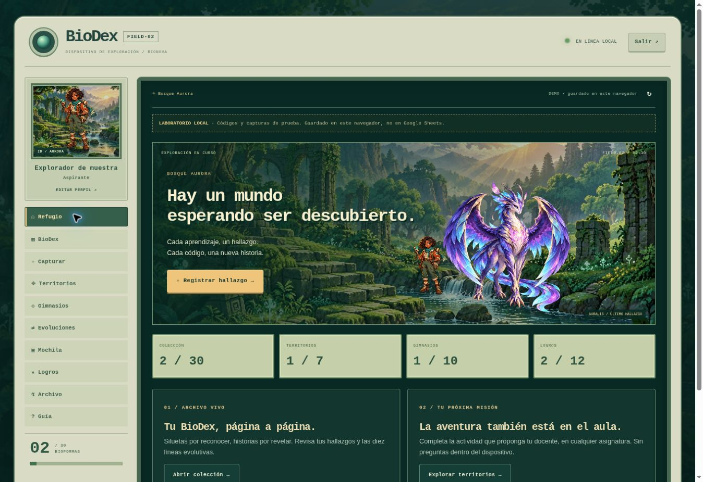

# BioDex 2.5 · FIELD-02

Remaster de la colección original: 30 bioformas y tres mega legendarias adicionales, mismos códigos CAP, SEC y GYM,
capturas animadas, sectores, gimnasios, inventario, medallas y evoluciones.
Sin banco de preguntas ni reflexión obligatoria. El docente decide las actividades
de cualquier asignatura y entrega los códigos existentes.

## Estado de conexión

La aplicación está conectada al Apps Script del docente mediante `config.js`.
Al abrir, **Ingresar** pide el nombre y la clave de seis dígitos ya creados.
**Crear personaje** registra una cuenta nueva con su avatar y paisaje. Un diálogo
retro muestra la consulta mientras se recupera la colección. El acceso a la colección requiere una cuenta. No hay demo, captura local ni códigos de ejemplo.

Sitio principal: https://nespinozagonzalez-hub.github.io/biodex/
La URL anterior de vista previa continúa disponible con la misma versión conectada.
Las cuentas se crean dentro de la app; no se introducen PINs manualmente en Sheets.
Para activar las reglas 2.4 en la implementación existente: [ACTUALIZAR_2_4.md](backend/ACTUALIZAR_2_4.md). Instalación desde cero: [INSTALACION_SHEETS.md](backend/INSTALACION_SHEETS.md).

La web detecta las capacidades del servidor. Hasta que el docente actualice su Apps Script, conserva las reglas antiguas de evolución y oculta los premios. El código del repositorio no demuestra que la nueva API esté desplegada.

## Edición retro FIELD-02

Carcasa de dispositivo de campo, pantalla de exploración, controles A/B y
tarjeta de explorador presente en toda la interfaz. Cuatro avatares y cuatro
paisajes seleccionables al entrar o desde el perfil. Los 33 recortes PNG
transparentes se usan durante la captura; la BioDex y las fichas
conservan las ilustraciones completas. La animación original permanece.

La bienvenida y el refugio muestran exclusivamente al entrenador ampliado sobre
el paisaje pixel art. En el refugio, el nombre del jugador protagoniza la pantalla.

La edición definitiva retira la exportación, importación y recuperación manual de
respaldos de la interfaz. La cuenta guarda y recupera el avance automáticamente.
Los datos locales de la edición anterior no se borran. La ruta antigua de Archivo
redirige al perfil; no puede importar ni sobrescribir la colección.

El escáner usa una señal genérica sin revelar una bioforma. Los gimnasios tienen
paisajes, emblemas, estados y filtros; las doce medallas muestran su progreso.
La mochila usa el mismo lenguaje de emblemas y describe el pasaporte de cuenta.

## Archivos

- `index.html`: colección, mecánicas originales, SVG de respaldo y animación de captura.
- `remaster.js`: acceso, validación remota, guardado confirmado e interfaz transversal.
- `remaster.css`: dirección visual bosque/pergamino/dorado, adaptación móvil.
- `retro.js` / `retro.css`: dispositivo FIELD-02, perfil, rutas de gimnasio y medallas.
- `megas.js`: galería y fichas de las tres distinciones únicas. Sin códigos privados.
- `assets/bioformas/`: ilustraciones optimizadas por bioforma.
- `assets/cutouts/`, `assets/avatars/`, `assets/landscapes/`: recortes, entrenadores y paisajes.
- `assets/FIELD_ART.md`: usos, direcciones de arte y prompts finales.
- `backend/Code.gs`: backend Apps Script vinculado a la hoja del docente.
- `tests/`: pruebas de reglas, backend con servicios simulados y navegador.

## Garantías del flujo

- El backend 2.4 permite capturar cada bioforma con su código en cualquier orden, sin requisitos de etapas o gimnasios.
- Los tres premios privados se generan en `PremiosMega`: un ganador por premio y una mega por cuenta, bajo bloqueo del servidor. No suman a las 30 capturas principales.
- Si el guardado de un premio se interrumpe, una reserva permite reparar el progreso desde la misma cuenta.
- Las activaciones se aplican sobre el progreso actual del servidor bajo bloqueo.
- Un navegador no puede sobrescribir la colección enviando un snapshot arbitrario.
- Cada captura se guarda **antes** de reproducir la animación.
- Un reintento devuelve el estado existente, sin duplicar capturas ni medallas.
- La clave de seis dígitos no se guarda en HTML, exportaciones ni texto plano en la hoja.
- Al salir se revoca la sesión; al restablecer una clave se revocan todas las sesiones.
- El progreso local antiguo se conserva; su migración requiere revisión docente.
- El remaster visual se carga después de los estilos heredados para evitar que la
  paleta antigua sobrescriba el diseño nuevo. `retro.css` se carga al final.
- Si el navegador bloquea sessionStorage (por ejemplo en ciertos iframes), la
  sesión puede funcionar en memoria: una captura confirmada no deja de mostrarse
  por ese bloqueo. Se avisa que habrá que ingresar otra vez al recargar.
- Avatar y paisaje se validan con listas permitidas al registrar o cambiar
  preferencias; no permiten enviar capturas arbitrarias ni sobrescribir progreso.

## Alcance de seguridad

Es un sistema educativo de bajo riesgo, no un servicio para datos sensibles.
Nombre y PIN de seis dígitos tienen una fortaleza limitada. El backend utiliza
HMAC con sal y secreto del servidor, límite de intentos y sesiones temporales.
La hoja debe ser privada. No usar RUT, notas, información de salud ni otros datos
sensibles. Los códigos antiguos ya existen en el historial público del repositorio;
preservarlos no equivale a convertirlos en secretos antifraude. El docente controla
su distribución, pero no se ofrece protección de evaluación de alto impacto.

El backend valida los códigos originales; no incorpora un calendario nuevo de
liberación. Solo los tres premios mega reciben códigos nuevos generados dentro de la hoja privada. Conservar la URL existente permite que los
iframes sigan apuntando al mismo sitio.

## Pruebas locales

Ejecutar `node --test tests/*.test.cjs`. Las pruebas
simulan servicios de Apps Script y un DOM mínimo. El resultado de la prueba
contra el despliegue real anterior se registra sin claves ni tokens en
[tests/LIVE_SHEETS_QA.json](tests/LIVE_SHEETS_QA.json). Ese archivo corresponde al backend anterior 2.0, no certifica el despliegue de 2.4. Ver [QA_2_4.md](tests/QA_2_4.md).

La verificación visual usa instantáneas de los renderizadores reales, sin sesión
ni solicitudes de cuenta, dentro de marcos de 320, 390, 768 y 1280 px. No equivale
a una emulación de iOS o Android ni a una prueba de acceso en un dispositivo físico.
Ver [QA_FIELD.md](tests/QA_FIELD.md).

Para revisar el sitio: `python -m http.server 8000`, abrir `http://localhost:8000`.

## Atlas de territorios · 2.4.1

Siete paisajes pixel art propios, índice navegable, filtros de estado y fichas con
los tres parajes de cada territorio. Se conservan los códigos SEC y el progreso
existente. Los diez gimnasios GYM mantienen su sección y códigos independientes.
El atlas se actualiza solo en la web; no requiere otro cambio en Apps Script.

- `territorios.js` / `territorios.css`: atlas, filtros, parajes y adaptación móvil.
- [Dirección de arte y prompts de los siete paisajes](assets/TERRITORY_ART.md).

El HTML del atlas no incluye valores funcionales de códigos. Las acciones de
captura y apertura siguen siendo validadas por el backend existente.

## Relatos de BioNova · 2.4.2

Las 33 bioformas reciben historias, rasgos y habilidades de fantasía propios.
Las fichas invitan a continuar la travesía, sin explicaciones curriculares ni
notas sobre la asignatura o el docente. La guía, el refugio, el atlas, la Liga
y la mochila usan el mismo lenguaje de aventura. La ayuda para restablecer una
clave conserva instrucciones reales y claras.

`narrativa.js` aplica únicamente una capa de presentación: los identificadores,
las claves de datos, los valores de atributos, los códigos, las reglas, las
imágenes y el progreso no cambian. Vitalidad, Ingenio, Percepción, Vínculo y
Energía son rótulos visuales; no añaden nuevas mecánicas.
Los scripts modificados usan `rev=2.4.2` para renovar la caché sin cambiar su
versión base. No requiere modificar Apps Script.

## Ambiente y presentación · 2.5

El botón **Sonido** abre música y efectos independientes, volúmenes y movimiento
reducido. El sonido empieza desactivado y se activa con un gesto del jugador. Las
preferencias se guardan solo en el dispositivo, sin modificar la cuenta o Sheets.
La música y los efectos se reproducen con elementos de audio HTML y archivos MP3
propios: tres composiciones originales (refugio, exploración y leyendas) y ocho
efectos, sin servicios externos. La descarga ocurre al reproducir. Al ocultar la
pestaña se pausa; un navegador puede pedir otro gesto para reanudarla.

Corrección 2.5.2: **Activar sonido** inicia la reproducción directamente.
**Probar sonido** reproduce una señal de prueba. Un bloqueo del navegador muestra
**Reactivar sonido**, sin afirmar que está reproduciendo. Si existe Audio Session,
se solicita el modo `playback`. No se necesita AudioContext. Las preferencias
locales de volumen y la lógica de cuentas se conservan.

Las pistas originales se pueden regenerar con `tools/render-audio.py` (NumPy y
FFmpeg). Los once archivos suman menos de 1 MB por copia del sitio.

**Historia** presenta un prólogo de tres escenas ilustradas con los paisajes de
BioNova. Puede omitirse y consultarse en cualquier momento. Las fichas capturadas
permiten ampliar el arte. Los linajes completos reciben un sello, y los nuevos
territorios, gimnasios, medallas y linajes confirmados tienen una celebración.
Las capturas distinguen hallazgos comunes, extraordinarios y mega, con un botón
para continuar sin esperar la animación. Escape también permite continuar.

`experiencia.js` / `experiencia.css` constituyen una capa independiente. No llaman
al servidor, no reemplazan funciones centrales y no escriben progreso. El HTML
solo carga ambos archivos después de las capas existentes. No se modificó
`backend/`, `config.js` ni los scripts originales. La versión `/preview/` es igual.

Checklist: [EXPERIENCIA_CHECKLIST.md](EXPERIENCIA_CHECKLIST.md).
Validación: [tests/QA_EXPERIENCIA_2_5.md](tests/QA_EXPERIENCIA_2_5.md).
