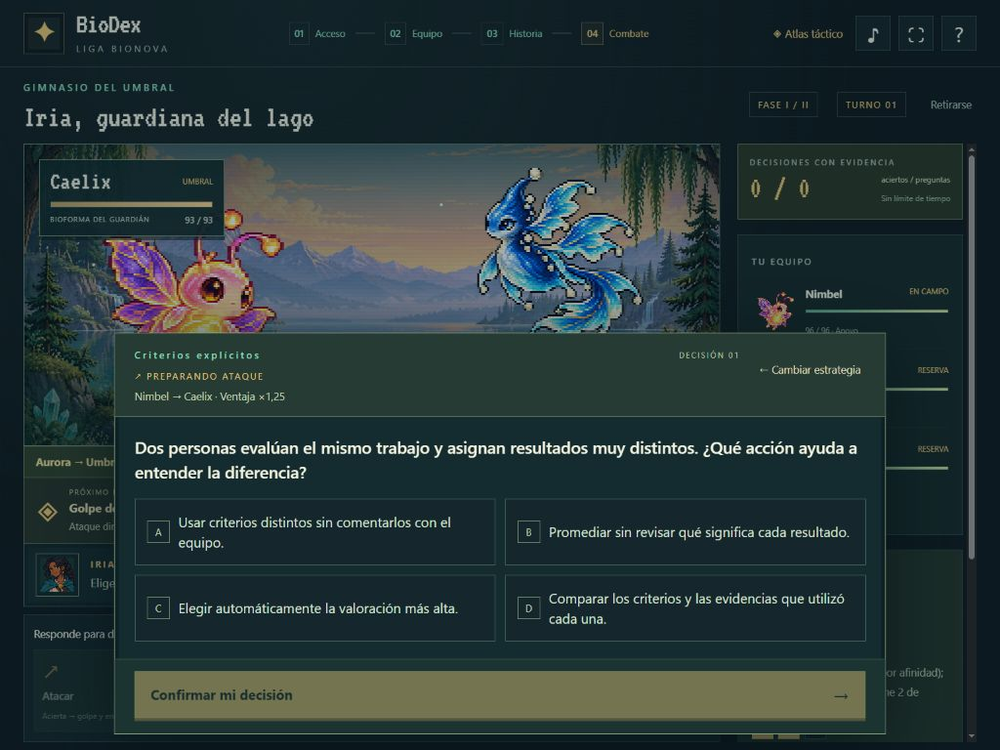

# Revisión de interfaz 1.1

Revisión del gimnasio publicado el 21 de octubre de 2026. Los tamaños corresponden al área CSS del navegador, mediante el control de viewport; no son pruebas en hardware físico.

| Vista | Resultado |
|---|---|
| Tablet horizontal, 1024 × 768 | Arena, información del rival y comandos dentro de la pantalla. Alto de página: 768 px; sin desplazamiento horizontal. |
| Tablet vertical, 768 × 1024 | Arena y comandos visibles; información táctica lateral con desplazamiento propio. Alto de página: 1024 px; sin desplazamiento horizontal. |
| PC, 1440 × 900 | Comandos terminan a 892 px; alto de página: 900 px; sin desplazamiento horizontal. |

## Equipo

- A 1024 × 768, el botón del gimnasio aparece antes de 650 px al entrar en la colección.
- Tras bajar 1000 px, el panel queda a 16 px del borde superior y el botón sigue visible.
- A 768 × 1024, tras vaciar el equipo y seleccionar la última bioforma (B033), el botón queda entre 323 y 370 px, con la colección desplazada 5520 px. Se habilita al seleccionar y se deshabilita con equipo vacío.

## Preguntas sobre la arena

- La pregunta usa un diálogo nativo con foco, contexto de bioforma y rival, y acción de confirmar siempre visible.
- Abrir, seleccionar, confirmar, leer explicación y ejecutar mantienen la posición de página.
- Antes de confirmar, volver a cambiar estrategia conserva la misma pregunta pendiente y no avanza el turno.
- Escape permite volver antes de confirmar. Tras calificar, la explicación permanece hasta ejecutar la resolución; Escape no evita la respuesta rival.
- Al confirmar se muestra la elección y la explicación, sin mantener cuatro alternativas ocupando la ventana.
- Se verificaron un acierto de habilidad con daño y un error con explicación y respuesta rival.

Las 22 pruebas del motor siguen aprobadas. Las modificaciones se limitan a la interfaz de gimnasios; no cambian el backend ni la colección de BioDex.
