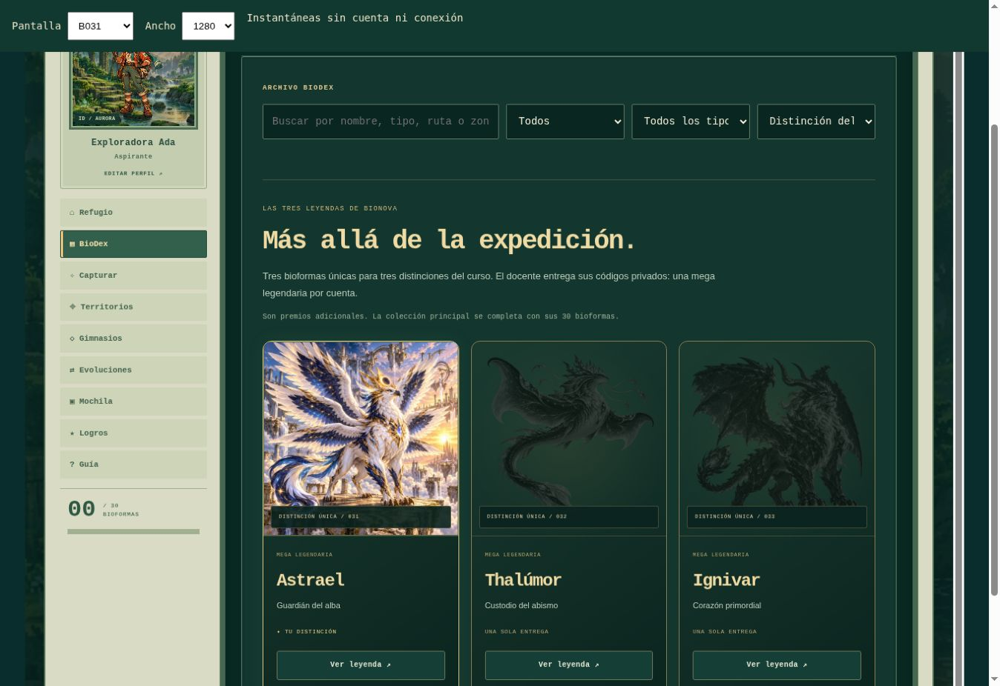

# BioDex 2.4 · Captura libre y tres distinciones

## Verificación automática

`node --test tests/*.test.cjs`: **42 pruebas aprobadas**.

- Las 30 bioformas se capturan en orden inverso sin etapas previas ni gimnasios.
- Los 47 códigos originales permanecen idénticos.
- Tres premios privados distintos, tres ganadores y una sola mega por cuenta.
- Un premio ya entregado rechaza otra cuenta; el ganador puede reintentarlo sin
  duplicar capturas, eventos ni medallas.
- Una reserva previa al guardado conserva la exclusividad tras un fallo de
  escritura; el ganador puede reparar su captura al reintentar.
- La reserva opcional al nombre de cuenta se respeta.
- Reinstalar conserva usuarios, PINs protegidos, secreto y códigos de premios.
- La API no devuelve códigos privados en progreso, intentos ni respuestas.
- Snapshots arbitrarios y migraciones no pueden conceder mega legendarias.
- Las mega no cuentan para las 30 capturas principales ni sus 12 logros.
- Backend antiguo: el cliente conserva las reglas anteriores y oculta premios.
- Backend 2.4: activa captura libre, búsqueda, filtros y galería de leyendas.
- Animación con PNG propio y ficha posterior con la ilustración WebP completa.
- Las tres ilustraciones y sus recortes son diferentes y están optimizados.
- El alpha real de los tres PNG se verificó también con Pillow: rango 0–255.

Los servicios de Google y el DOM se simulan en estas pruebas. No representan una
prueba de guardado contra la nueva implementación real.

## Despliegue de Google

El docente debe reemplazar `Code.gs`, ejecutar `instalarBioDex` y actualizar la
versión de la implementación existente. Instrucciones completas:
[ACTUALIZAR_2_4.md](../backend/ACTUALIZAR_2_4.md).

El reporte `LIVE_SHEETS_QA.json` se conserva como evidencia histórica del backend
2.0; no certifica que 2.4 ya esté publicado. Los premios reales no se usan como
datos de prueba. No se han creado nuevas cuentas ni consumido premios en Sheets
para esta actualización.

## Revisión visual

24 combinaciones aprobadas: siluetas, Astrael, Thalúmor, Ignivar, escáner y refugio
con premio, cada una a 320, 390, 768 y 1280 px. Sin desplazamiento horizontal ni
controles o tarjetas fuera del ancho. Medidas: [LAYOUT_2_4.json](LAYOUT_2_4.json).
Son instantáneas sin cuentas reales; no emulan un dispositivo iOS/Android físico.

El GET al endpoint existente se comprobó durante la entrega: todavía responde
`{"ok":true,"service":"BioDex","version":"2.0.0"}`. La captura libre y los
premios no estarán activos hasta que el docente actualice esa implementación.
