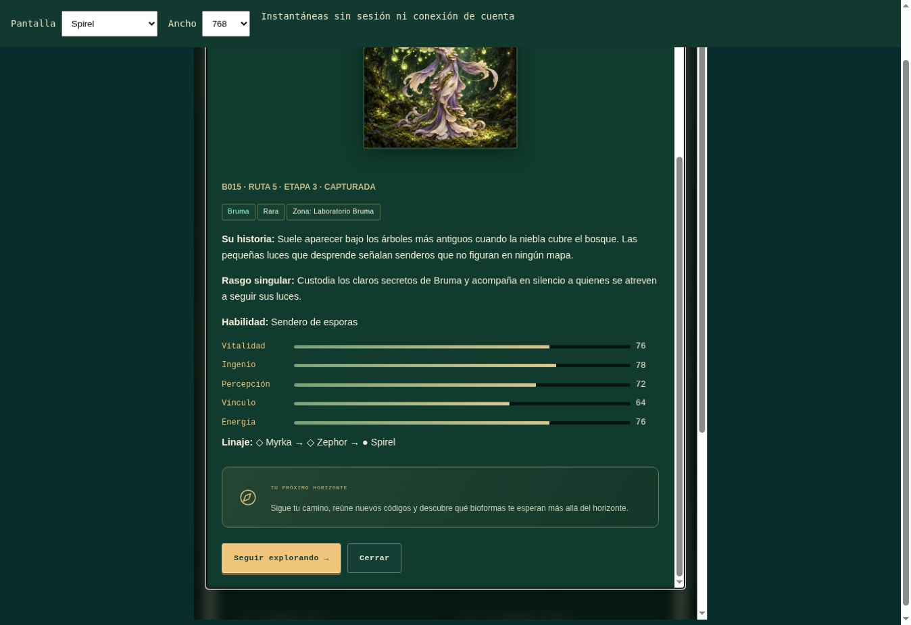

# Relatos de BioNova · 2.4.2

`node --test tests/*.test.cjs`: **56 pruebas aprobadas**.

- Las 33 bioformas tienen historias, rasgos y habilidades de fantasía propios.
- La ficha de Spirel sustituye las explicaciones curriculares por su relato y
  una invitación a continuar explorando.
- Las fichas reveladas y pendientes, el refugio, el atlas, los gimnasios, los
  linajes, la mochila y los logros no usan explicaciones de aula o asignatura.
- La ayuda de cuenta conserva instrucciones reales de restablecimiento de clave.
- Vitalidad, Ingenio, Percepción, Vínculo y Energía son rótulos visuales: los
  valores y las claves internas de los atributos se mantienen.
- La carga de la capa narrativa conserva los identificadores, las reglas,
  las cuentas, las sesiones, los logros y el progreso sin peticiones al servidor.
- Los códigos se siguen validando por el mismo backend. Apps Script no cambia.
- Se mantienen las ilustraciones completas, los PNG y las animaciones.

Las pruebas de servicios de Google y DOM usan entornos simulados. No se han
creado cuentas ni alterado progreso real para esta actualización.

## Revisión visual

36 combinaciones aprobadas en navegador: refugio, Spirel capturada, Nimbel
pendiente, Astrael pendiente, escáner, atlas, gimnasios, linajes y guía, cada una
a 320, 390, 768 y 1280 px. Sin desplazamiento horizontal ni controles, atributos
o notas fuera del ancho disponible. Las vistas son instantáneas de los
renderizadores reales, sin sesión ni peticiones de progreso; no constituyen una
prueba de acceso en dispositivos iOS/Android físicos.

Medidas: [LAYOUT_RELATOS_2_4_2.json](LAYOUT_RELATOS_2_4_2.json).

